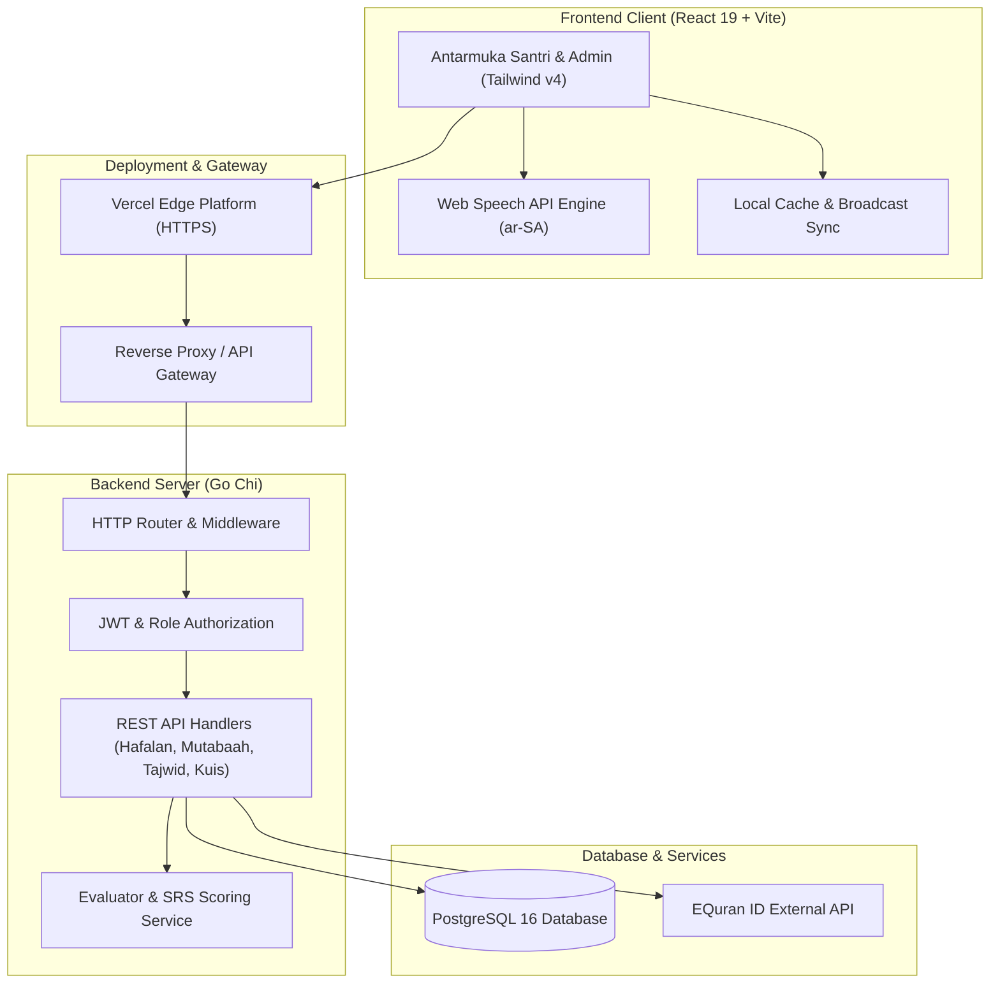
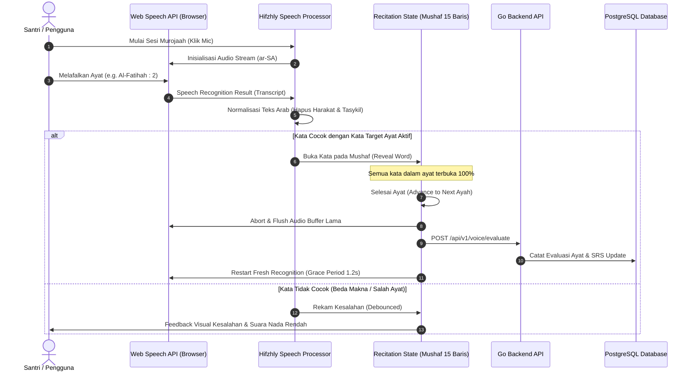
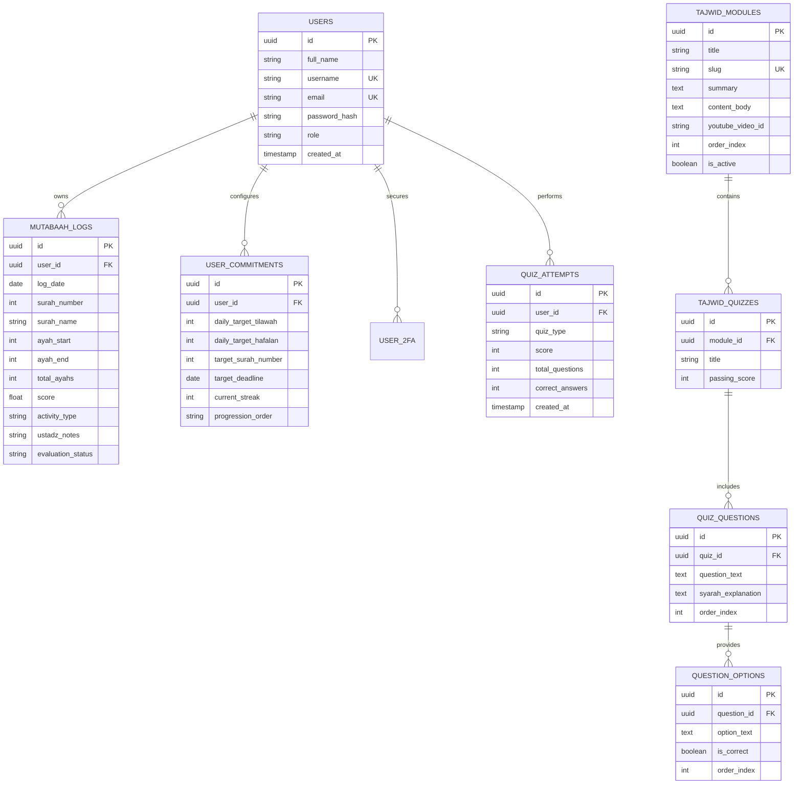

# Hifzhly - Platform Murojaah & Evaluasi Hafalan Al-Qur'an Cerdas

Hifzhly adalah platform edtech Islami modern yang dirancang untuk mendampingi santri, huffazh, dan kaum Muslimin dalam menjaga kemutqinan hafalan Al-Qur'an (*murojaah*). Dilengkapi dengan pengenal suara (*speech recognition*) real-time per kata, tampilan mushaf Madinah 15 baris, buku mutabaah digital berbasis retensi, silabus tajwid terverifikasi, dan gamifikasi kuis Al-Qur'an.

- **URL Aplikasi**: [https://hifzhly.vercel.app](https://hifzhly.vercel.app)
- **Repository**: [https://github.com/firdyridho/HIFZHLY](https://github.com/firdyridho/HIFZHLY)

---

## Daftar Isi

1. [Latar Belakang & Visi Proyek](#latar-belakang--visi-proyek)
2. [Fitur-Fitur Utama](#fitur-fitur-utama)
3. [Arsitektur Sistem](#arsitektur-sistem)
4. [Tech Stack](#tech-stack)
5. [Struktur Proyek](#struktur-proyek)
6. [Panduan Instalasi & Menjalankan Proyek](#panduan-instalasi--menjalankan-proyek)
7. [Kontribusi Anggota Tim](#kontribusi-anggota-tim)
8. [AI Use Declaration](#ai-use-declaration)
9. [Third-Party Declaration](#third-party-declaration)
10. [Lisensi & Penutup](#lisensi--penutup)

---

## Latar Belakang & Visi Proyek

Menghafal Al-Qur'an adalah ikhtiar mulia yang membutuhkan istiqomah sepanjang hayat. Namun, lebih dari 70% santri dan penghafal mandiri menghadapi kendala:

1. **Keterbatasan Waktu Simakan (*Tasmi'* Ustadz)**: Rasio musyrif dan santri yang tinggi di pondok membuat alokasi simakan per anak sangat terbatas (hanya 5–10 menit per hari).
2. **Pencatatan Mutabaah Kertas yang Manual**: Rawan tercecer, subjektif, dan sulit dianalisis tren penurunan retensinya oleh wali santri maupun ustadz.
3. **Kebuntuan Murojaah Mandiri**: Santri sering lupa kelanjutan ayat saat mengulang sendiri, memecah konsentrasi karena harus membuka mushaf berulang kali.

**Visi Hifzhly**: Menghadirkan asisten murojaah digital 24/7 yang teliti, mendidik, dan menyenangkan tanpa mengurangi kesakralan dan adab dalam mempelajari kalamullah.

---

## Fitur-Fitur Utama

### 1. Murojaah & Hafalan Suara Real-Time (Speech Recognition)
- **Format Mushaf Madinah 15 Baris**: Mempertahankan tata letak visual ayat persis mushaf cetak standar para huffazh.
- **Mulai dari Kosong (*Blank Canvas*)**: Menantang daya ingat murni santri. Kata-kata akan terbuka secara otomatis hanya jika dilafalkan dengan benar.
- **Bantuan Kata Berkala**: Jika santri mengalami kebuntuan ingatan, tombol bantuan dapat membuka satu kata berikutnya sebagai petunjuk tanpa merusak sesi.
- **Isolasi Buffer Suara Per-Ayat**: Algoritma transisi otomatis memastikan sisa suara dari ayat sebelumnya tidak bocor ke ayat berikutnya, mengeliminasi deteksi kesalahan palsu (*false-alarms*).
- **Modal Analisis Kesalahan**: Mencatat kata yang keliru, lafal yang diucapkan, dan teks rujukan uthmani yang benar untuk evaluasi makhraj.

### 2. Mutabaah Yaumiyyah Digital & Heatmap Retensi Juz 30
- **Peta Visual Retensi Surah**: Indikator warna dinamis dari Hijau Tua (Mutqin, skor >= 90), Hijau Muda (Cukup), Kuning (Perlu Diulang), hingga Abu-abu (Belum disetor).
- **Target & Komitmen Ibadah Mandiri**: Pengaturan fleksibel target tilawah harian (ayat & halaman), target hafalan baru, target murojaah (surah, ayat, atau halaman), dan pilihan urutan (Juz 30, Juz 1 Ascending, atau Custom).
- **Log Kalender & Day Streak**: Riwayat murojaah otomatis harian, pelacakan hari berturut-turut, serta modul verifikasi resmi oleh ustadz pembimbing.

### 3. Kurikulum Tajwid Terstruktur
- Modul pembelajaran kaidah tajwid lengkap bersumber dari kaidah makharijul huruf dan sifatul huruf standar Jazariyyah (Hukum Nun Sukun, Mim Sukun, Ghunnah Musyaddadah, Madd, dll.).
- Evaluasi pemahaman melalui paket kuis pilihan ganda terstruktur dengan syarah/pembahasan mendalam di setiap butir soal.

### 4. Game Kuis Al-Qur'an & Leaderboard Bulanan
- **Mode Tebak Surah & Nomor Ayat**: Menguji kepekaan santri terhadap identitas ayat yang ditampilkan.
- **Mode Sambung Ayat**: Melatih kelancaran ingatan lafal berikutnya dari potongan ayat acak.
- **Filter Rentang Juz (1 s/d 30)**: Memungkinkan penyesuaian kuis dengan kapasitas hafalan masing-masing santri.
- **Top 10 Leaderboard Bulanan**: Papan peringkat terakumulasi yang di-reset berkala setiap awal bulan untuk menumbuhkan motivasi kompetisi sehat (*fastabiqul khairat*).

### 5. Fasilitas Ibadah Penunjang
- **Jadwal Shalat Akurat via GPS**: Menggunakan API shalat terverifikasi yang menyesuaikan otomatis dengan koordinat lokasi pengguna.
- **Qari Audio Selector**: Pilihan murottal audio jernih (Syaikh Misyari Rasyid Al-Afasy) untuk membantu talaqqi mandiri.
- **Koleksi Doa & Dzikir Shahih**: Himpunan doa sebelum/sesudah menghafal, doa khotmil Qur'an, sayyidul istighfar, dan doa mustajab bersumber Al-Qur'an dan As-Sunnah.

### 6. Keamanan & Akun Santri
- Otentikasi berbasis JWT dengan proteksi rute ketat (*client-side & server-side*).
- Indikator kekuatan password (*Password Strength Meter*) dan validasi konfirmasi kata sandi.
- **Two-Factor Authentication (2FA)**: Dukungan pemindaian QR Code visual standar TOTP untuk Google Authenticator dan Authy.

---

## Arsitektur Sistem

### 1. High-Level Architecture



### 2. User Recitation & Evaluation Flow



### 3. Entity-Relationship Diagram (ERD)



---

## Tech Stack

| Layer | Komponen / Teknologi | Keterangan |
|---|---|---|
| **Frontend Framework** | React 19, TypeScript, Vite | Single Page Application berperforma tinggi |
| **Styling & UI Icons** | Tailwind CSS v4, Lucide React | Scholarly Islamic UI tanpa emoji generik (Anti-AI-slop standard) |
| **Audio & Speech AI** | Web Speech API (`ar-SA`), Tilawa Voice Core | Pengenal pelafalan Arab real-time terisolasi |
| **Backend Language** | Go 1.23 | REST API berperforma tinggi dengan *low resource footprint* |
| **HTTP Routing** | Chi Router (`go-chi/chi/v5`) | Router modular, cepat, dan standar industri Go |
| **Database & ORM** | PostgreSQL 16, `jackc/pgx/v5` | Database relasional dengan native connection pool |
| **Autentikasi & Security** | JWT (JSON Web Tokens), `golang.org/x/crypto/bcrypt`, TOTP 2FA | Enkripsi kata sandi dan proteksi sesi berlapis |
| **Hosting & Deployment** | Vercel (Frontend), VPS Linux (Backend & Database) | Skalabilitas tinggi dengan reverse proxy |

---

## Struktur Proyek

```text
Hifzhly/
├── backend/
│   ├── cmd/
│   │   └── api/                # Entrypoint server Go (main.go)
│   ├── internal/
│   │   ├── config/             # Konfigurasi environment (Viper/Env)
│   │   ├── database/           # Pool koneksi PostgreSQL (pgxpool)
│   │   ├── evaluator/          # Algoritma evaluasi suara & pencocokan teks
│   │   ├── handler/            # Controller HTTP REST API
│   │   ├── middleware/         # Auth, CORS, Logger, Recoverer
│   │   ├── model/              # Deklarasi entitas & DTO structs
│   │   ├── repository/         # Query layer database SQL
│   │   ├── service/            # Business logic (Auth, Mutabaah, Tajwid, Kuis)
│   │   └── srs/                # Spaced Repetition System calculation
│   └── migrations/             # Migrasi skema database PostgreSQL
├── frontend/
│   ├── public/                 # Favicon dan aset statis
│   ├── src/
│   │   ├── components/         # Komponen UI modular (Mushaf, Mutabaah, Admin)
│   │   ├── lib/                # Layanan client (mutabaahService, quranMeta, tajwidStore)
│   │   ├── pages/              # Halaman aplikasi (Murojaah, Hafalan, Mutabaah, Tajwid, Quiz, Settings)
│   │   ├── routes/             # Konfigurasi React Router & ProtectedRoute
│   │   └── types/              # Deklarasi TypeScript interfaces
│   ├── index.html              # HTML entry point
│   ├── package.json            # Dependensi frontend
│   ├── tailwind.config.js      # Konfigurasi tema Tailwind CSS
│   ├── vercel.json             # Konfigurasi rewrite proxy Vercel
│   └── vite.config.ts          # Konfigurasi bundler Vite
└── README.md                   # Dokumentasi resmi proyek Hifzhly
```

---

## Panduan Instalasi & Menjalankan Proyek

### Prasyarat
- **Node.js**: v20.x atau lebih baru
- **Go**: v1.23.x atau lebih baru
- **PostgreSQL**: v15.x atau lebih baru (opsional jika menggunakan database remote)
- **Git**

### 1. Kloning Repositori
```bash
git clone https://github.com/firdyridho/HIFZHLY.git
cd HIFZHLY
```

### 2. Menjalankan Frontend
```bash
cd frontend
npm install
npm run dev
```
Aplikasi frontend akan aktif di `http://localhost:5173`.
> **Catatan**: Secara default, konfigurasi proxy Vite diatur untuk langsung menghubungkan request `/api` ke backend server VPS aktif (`http://43.129.37.163:8080`), sehingga Anda dapat langsung mencoba seluruh fitur database tanpa harus menjalankan backend lokal.

### 3. Menjalankan Backend (Opsional / Pengembangan Mandiri)
Jika ingin menjalankan backend Go di komputer lokal:
```bash
cd backend

# Konfigurasikan file .env lokal (lihat contoh pada internal/config)
# Jalankan migrasi database bila diperlukan
go run cmd/api/main.go
```
Server backend lokal akan aktif di `http://localhost:8080`.

---

## Kontribusi Anggota Tim

Proyek Hifzhly dikembangkan oleh **FIFA Team**:

| Anggota Tim | Peran & Tanggung Jawab Utama |
|---|---|
| **Firdy Ridho Fillah** | **Lead Full-Stack Developer & System Architect**<br>• Perancangan arsitektur sistem backend Go Chi dan integrasi PostgreSQL.<br>• Implementasi mesin speech recognition mushaf 15 baris dan isolasi buffer audio per-ayat.<br>• Pengembangan modul Mutabaah Yaumiyyah, heatmap retensi Juz 30, dan sistem target santri.<br>• Integrasi keamanan Two-Factor Authentication (2FA TOTP QR Code) dan proteksi navigasi auth. |
| **Faeyza Ardellein** | **Frontend Engineer & UI/UX Specialist**<br>• Desain antarmuka responsif ramah mobile berbasis Tailwind CSS v4 sesuai panduan Anti-AI-slop.<br>• Implementasi modul kuis interaktif, game sambung ayat, dan papan peringkat bulanan (Leaderboard Top 10).<br>• Integrasi modul kurikulum tajwid berstandar, pemutar audio qari resmi, dan widget jadwal shalat geolokasi. |

---

## AI Use Declaration

Pengembangan proyek Hifzhly menerapkan prinsip **Transparansi dan Etika Pemanfaatan AI (*Ethical AI Use*)**:

1. **Bantuan Pengembangan Perangkat Lunak**:
   - Model kecerdasan buatan (Google Antigravity / Claude / Gemini) dimanfaatkan sebagai asisten pemrograman untuk mempercepat penulisan boilerplate code, refactor komponen, optimalisasi query SQL, serta penyusunan skrip migrasi database.
2. **Algoritma Pengenal Suara Al-Qur'an**:
   - Sistem memanfaatkan Web Speech API dan konsep fonetik tilawah untuk membandingkan suara ucapan pengguna dengan teks mushaf rujukan.
3. **Validasi Manusia (*Human-in-the-Loop*) Terhadap Teks Suci**:
   - Seluruh teks ayat suci Al-Qur'an, harakat uthmani, terjemahan resmi Kemenag RI, serta kaidah hukum tajwid **tidak di-generate secara bebas oleh AI generatif**, melainkan diambil dari sumber dataset Al-Qur'an terverifikasi dan telah divalidasi keabsahannya oleh tim pengembang guna menjamin ketepatan huruf dan harakat kalamullah.

---

## Third-Party Declaration

Platform Hifzhly memanfaatkan pustaka, API, dan sumber daya pihak ketiga berikut dengan mematuhi lisensi masing-masing:

1. **EQuran.id API (`https://equran.id`)**:
   - Digunakan untuk data surah, audio murottal per-ayat (Syaikh Misyari Rasyid), jadwal shalat kota Indonesia, dan kumpulan doa harian.
2. **OpenStreetMap / Nominatim API**:
   - Digunakan untuk penentuan nama wilayah dan koordinat geografis pengguna secara aman guna perhitungan waktu shalat akurat.
3. **Lucide Icons (`lucide-react`)**:
   - Koleksi ikon SVG profesional di bawah lisensi MIT yang digunakan sebagai standar visual aplikasi menggantikan penggunaan emoji generik.
4. **PptxGenJS**:
   - Digunakan untuk membangun berkas presentasi resmi (*pitch deck*) dalam format PowerPoint (`.pptx`).
5. **Chart.js & KaTeX**:
   - Pustaka visualisasi grafik statistik capaian santri dan render penulisan ilmiah.

---

## Lisensi & Penutup

Proyek ini dikembangkan untuk kemaslahatan pendidikan Al-Qur'an di Indonesia. Seluruh hak cipta kode program berada di bawah kepemilikan **FIFA Team / Hifzhly Indonesia**.

> *"Sebaik-baik kalian adalah orang yang belajar Al-Qur'an dan mengajarkannya."*  
> **(HR. Bukhari no. 5027)**
