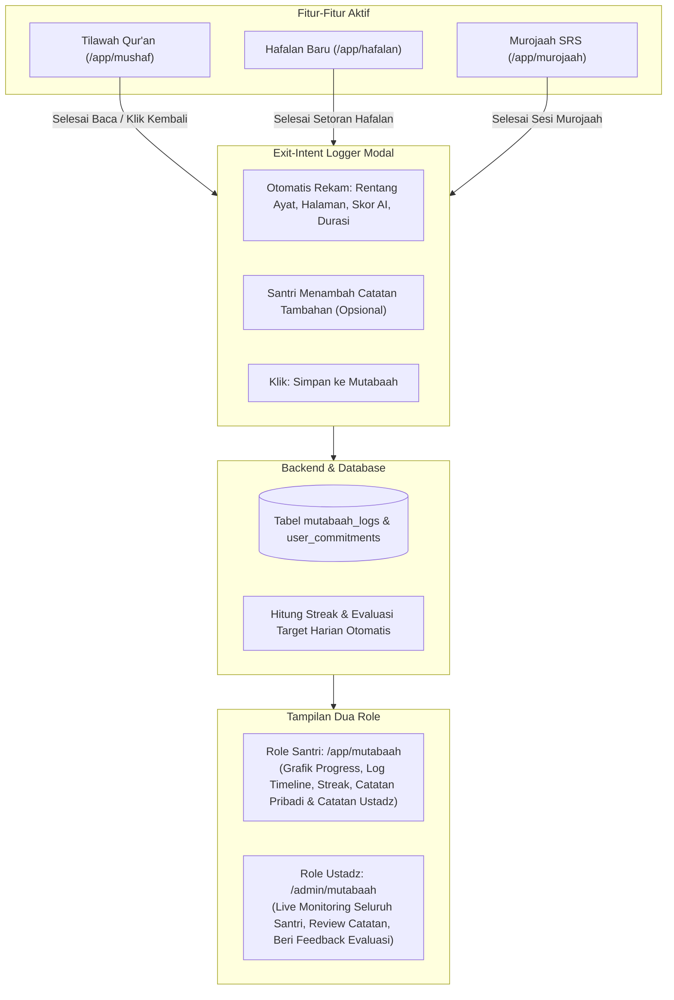

# Spesifikasi Desain & Roadmap Sistem Mutabaah Terpadu Hifzhly

> **Konsep Inti**: Mutabaah Yaumiyyah adalah pusat data tunggal (*Single Source of Truth*) yang mengumpulkan seluruh aktivitas ibadah Al-Qur'an santri secara otomatis dari fitur Tilawah, Hafalan Baru, dan Murojaah, dilengkapi fitur *Exit-Intent Logger Modal*, pemantauan komitmen target, serta evaluasi dari Ustadz/Musyrif.

---

## 1. Alur Interaksi & Kebutuhan Pengguna



---

## 2. Rincian Fitur Berdasarkan Dua Role

### A. Role Santri (Penghafal / User)
1. **Pencatatan Otomatis (Zero-Friction Logging)**:
   - Santri tidak perlu berpindah ke halaman Mutabaah untuk menulis jurnal manual.
   - **Di Fitur Qur'an (`/app/mushaf`)**: Sistem mencatat ayat awal yang dibaca s.d. ayat terakhir, jumlah halaman/lembar, dan durasi membaca.
   - **Di Fitur Murojaah & Hafalan**: Sistem otomatis mencatat ayat yang disetorkan, akurasi suara AI Whisper/Levenshtein, status repetisi SRS, dan nilai kualitas hafalan.
2. **Dialog Konfirmasi Sebelum Keluar (*Exit-Intent Logger Modal*)**:
   - Muncul langsung di halaman fitur yang sedang dibuka saat santri selesai membaca atau menekan tombol kembali (`<-`).
   - Berisi ringkasan aktivitas yang sudah terisi otomatis (*pre-filled*): *"Alhamdulillah! Anda telah membaca QS. Al-Baqarah:142–160 (19 ayat • 2 lembar)"*.
   - Kolom isian **Catatan Santri** (opsional): Santri bisa menuliskan refleksi atau kendala (misal: *"Ayat 155 makhraj 'ain masih kurang mantap"*).
   - Tombol cepat: **[Simpan ke Mutabaah]** atau **[Lewati]**.
3. **Pengaturan Target & Komitmen Mandiri**:
   - Santri dapat menetapkan target pribadi:
     - Target tilawah harian (misal: 10 lembar / 1 juz per hari).
     - Target hafalan surat pilihan (misal: Surah Al-Mulk ayat 1–10).
     - Target pengulangan murojaah harian (misal: 15 ayat SRS per hari).
   - Sistem otomatis mencocokkan aktivitas harian dengan target: jika target terpenuhi, status harian menjadi *"Target Tercapai"* dan streak api konsistensi bertambah.
4. **Halaman Dashboard Mutabaah (`/app/mutabaah`)**:
   - Khusus digunakan untuk melihat rangkuman progres lengkap:
     - Kartu Streak & Konsistensi Harian.
     - Progress Bar Capaian Target Surat & Lembar.
     - Timeline Riwayat Jurnal Mutabaah.
     - Melihat balasan/catatan evaluasi dari Ustadz pembimbing.

---

### B. Role Ustadz / Musyrif (Admin)
1. **Live Monitoring Mutabaah Santri (`/admin` atau `/admin/mutabaah`)**:
   - Ustadz dapat melihat tabel rekapitulasi harian seluruh santri:
     - Siapa yang sudah tilawah dan sampai ayat/halaman berapa.
     - Siapa yang sudah setoran hafalan dan berapa skor akurasi AI-nya.
     - Siapa santri yang belum menuntaskan target komitmen hari ini.
2. **Review Detail Jurnal Santri**:
   - Ustadz dapat membuka detail entri mutabaah santri dan membaca catatan kendala yang ditulis oleh santri.
3. **Pemberian Catatan / Evaluasi Musyrif**:
   - Ustadz dapat memberikan umpan balik langsung pada entri mutabaah santri:
     - Status penilaian: `Disetujui (Mumtaz)` / `Perlu Diulang` / `Perlu Bimbingan Khusus`.
     - Catatan evaluasi Ustadz (misal: *"Alhamdulillah sudah lancar, perhatikan panjang mad jaiz di ayat 158"*).
   - Catatan ini langsung tersinkronisasi dan tampil di kartu mutabaah santri.

---

## 3. Spesifikasi Teknis Database & API

### A. Skema Tabel Database (PostgreSQL)

```sql
-- 1. Tabel Log Mutabaah Terpadu
CREATE TABLE IF NOT EXISTS mutabaah_logs (
    id UUID PRIMARY KEY DEFAULT gen_random_uuid(),
    user_id UUID NOT NULL REFERENCES users(id) ON DELETE CASCADE,
    log_date DATE NOT NULL DEFAULT CURRENT_DATE,
    activity_type VARCHAR(30) NOT NULL, -- 'tilawah', 'hafalan_baru', 'murojaah', 'tajwid_quiz'
    surah_number INT NOT NULL,
    surah_name VARCHAR(100) NOT NULL,
    start_ayah INT NOT NULL,
    end_ayah INT NOT NULL,
    total_ayahs INT NOT NULL,
    pages_count INT DEFAULT 1,
    duration_seconds INT DEFAULT 0,
    score NUMERIC(5,2) DEFAULT NULL, -- Nilai AI (0-100) bila hafalan/murojaah
    santri_notes TEXT DEFAULT NULL,
    ustadz_notes TEXT DEFAULT NULL,
    ustadz_id UUID REFERENCES users(id) ON DELETE SET NULL,
    status VARCHAR(30) DEFAULT 'completed', -- 'completed', 'verified', 'needs_improvement'
    created_at TIMESTAMP WITH TIME ZONE DEFAULT NOW()
);

-- 2. Tabel Target & Komitmen Mandiri Santri
CREATE TABLE IF NOT EXISTS user_commitments (
    id UUID PRIMARY KEY DEFAULT gen_random_uuid(),
    user_id UUID NOT NULL REFERENCES users(id) ON DELETE CASCADE,
    daily_target_ayahs_tilawah INT DEFAULT 20,
    daily_target_pages_tilawah INT DEFAULT 2,
    daily_target_ayahs_hafalan INT DEFAULT 5,
    target_surah_number INT DEFAULT NULL,
    target_surah_name VARCHAR(100) DEFAULT NULL,
    target_start_ayah INT DEFAULT 1,
    target_end_ayah INT DEFAULT NULL,
    target_deadline DATE DEFAULT NULL,
    current_streak INT DEFAULT 0,
    max_streak INT DEFAULT 0,
    updated_at TIMESTAMP WITH TIME ZONE DEFAULT NOW()
);
```

### B. Daftar Endpoint RESTful API

| Method | Endpoint | Akses | Fungsi |
| :--- | :--- | :--- | :--- |
| `POST` | `/api/v1/mutabaah/log` | Santri | Menyimpan entri mutabaah dari dialog exit-modal fitur |
| `GET` | `/api/v1/mutabaah/summary` | Santri | Ringkasan streak, target terpenuhi hari ini, dan aktivitas mingguan |
| `GET` | `/api/v1/mutabaah/history` | Santri | Riwayat timeline aktivitas mutabaah santri (filter tanggal & tipe) |
| `GET` | `/api/v1/mutabaah/targets` | Santri | Mengambil target komitmen aktif santri |
| `PUT` | `/api/v1/mutabaah/targets` | Santri | Memperbarui target komitmen santri (ayat/lembar/surah) |
| `GET` | `/api/v1/admin/mutabaah/monitoring` | Ustadz | Rekap live seluruh santri hari ini (kepatuhan target & aktivitas) |
| `POST`| `/api/v1/admin/mutabaah/:id/evaluation`| Ustadz | Memberikan catatan evaluasi ustadz & approval |

---

## 4. Rincian Task Pembagian Kerja (Checklist)

### Fase 1: Backend Database & Endpoints
- [ ] Buat migrasi SQL tabel `mutabaah_logs` dan `user_commitments`.
- [ ] Implementasikan `MutabaahRepository.CreateLog` & `MutabaahRepository.GetHistory`.
- [ ] Implementasikan endpoint `POST /api/v1/mutabaah/log` dengan kalkulasi otomatis streak konsistensi.
- [ ] Implementasikan endpoint `GET /api/v1/mutabaah/targets` dan `PUT /api/v1/mutabaah/targets`.
- [ ] Implementasikan endpoint `GET /api/v1/admin/mutabaah/monitoring` dan `POST /api/v1/admin/mutabaah/:id/evaluation`.

### Fase 2: Frontend Exit-Intent Logger Modal
- [ ] Buat komponen modal terpadu `ExitMutabaahModal.tsx` (Pre-filled ringkasan ayat, durasi, lembar, input catatan santri).
- [ ] Pasang tracker interaksi di `MushafPage.tsx`: catat rentang ayat/halaman saat membaca, picu modal saat klik `<- Kembali ke Katalog`.
- [ ] Pasang tracker di `MurojaahPage.tsx`: picu modal pasca setoran suara AI selesai.

### Fase 3: Dashboard Mutabaah Santri (`MutabaahPage.tsx`)
- [ ] Hubungkan kartu ringkasan dengan `GET /api/v1/mutabaah/summary`.
- [ ] Buat tab Jurnal Aktivitas & Riwayat Catatan (menampilkan timeline tilawah, hafalan, skor AI, catatan santri, dan balasan catatan ustadz).
- [ ] Buat kartu/modal Target Komitmen Mandiri (atur target surat, target lembar/ayat harian).

### Fase 4: Dashboard Ustadz / Musyrif (`AdminDashboardPage.tsx`)
- [ ] Buat tabel Live Monitoring Kepatuhan Santri (Status hari ini: Tilawah, Setoran, Target Tercapai).
- [ ] Buat drawer detail inspeksi aktivitas santri & form kirim Catatan Evaluasi Musyrif.

