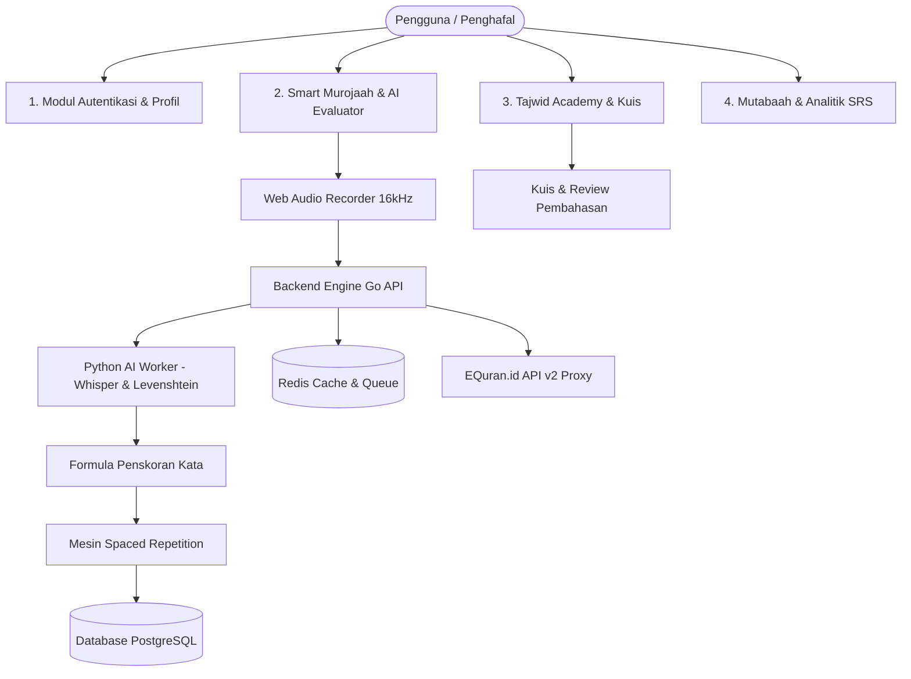

# PRD - Hifzhly: Platform Murojaah Al-Qur'an Berbasis AI, Edukasi Tajwid, dan Spaced Repetition

| Atribut | Keterangan |
| :--- | :--- |
| **Nama Produk** | Hifzhly (Al-Qur'an Murojaah & Tajwid Adaptive Companion) |
| **Versi Dokumen** | 1.0 (Arsitektur Full-Stack & AI Terintegrasi) |
| **Status** | Aktif / Hackathon FIFA 24 Jam |
| **Subtema** | Subtema 1: Inclusive Education and Future Skills |
| **Tim Pengembang** | Tim FIFA (Firdy Ridho Fillah & Faeyza Ardellein Yaradhitya) |
| **Ketua Tim (Backend & AI)** | Firdy Ridho Fillah |
| **Anggota (Frontend & UI/UX)**| Faeyza Ardellein Yaradhitya |
| **Tanggal Pembaruan** | 2026-10-31 |
| **Dokumen Terkait** | [`ERD.md`](./ERD.md) / [`API.md`](./API.md) / [`API_CONTRACT_AGREEMENT.md`](./API_CONTRACT_AGREEMENT.md) / [`TASKS.md`](./TASKS.md) / [`DEPLOYMENT_GUIDE.md`](./DEPLOYMENT_GUIDE.md) |

---

## 1. Ringkasan Eksekutif

**Hifzhly** adalah platform murojaah Al-Qur'an terpadu yang menggabungkan kecerdasan buatan (*Artificial Intelligence - AI*) dengan prinsip pedagogi kognitif untuk mendampingi santri, pelajar, dan penghafal mandiri dalam memelihara serta meningkatkan kualitas hafalan Al-Qur'an. Berakar dari kata *Hifz* (حفظ - menjaga/menghafal) dan sufiks *-ly* (mencerminkan rutinitas harian yang modern dan konsisten), platform ini mengintegrasikan:

1. **AI Voice Evaluator Real-Time**: Evaluasi suara bacaan mandiri kata demi kata berbasis model speech recognition Whisper (`whisper-base-ar-quran`), Voice Activity Detection (VAD), dan algoritma penyejajaran jarak edit Levenshtein terhadap teks standar Mushaf Madinah/EQuran.id.
2. **Adaptive Spaced Repetition System (SRS)**: Algoritma pengulangan terjadwal adaptif (mengadaptasi SuperMemo-2) yang secara otomatis menghitung kurva kelupaan per ayat berdasarkan riwayat skor AI bacaan pengguna.
3. **Interactive Tajwid Academy & Evaluation**: Modul pembelajaran teori tajwid terstruktur dengan media teks penjelas, integrasi video YouTube, kuis interaktif evaluatif, serta layar review pembahasan rinci per butir soal.
4. **Digital Mutabaah & Analytics**: Pencatatan riwayat hafalan otomatis, analitik konsistensi streak harian, peta visual retensi ayat (ayat lemah vs. ayat mutqin), dan pelaporan mandiri terstruktur.

Aplikasi dirancang untuk diwujudkan dalam prototipe produksi fungsional dalam waktu **24 Jam Hackathon** menggunakan pemisahan tegas antara arsitektur Backend berkinerja tinggi (Go REST API + Redis + PostgreSQL + Python AI Worker) dan antarmuka web interaktif responsif (React, Vite, Tailwind CSS).

---

## 2. Masalah dan Latar Belakang

### 2.1 Permasalahan Nyata
* **Tantangan Mempertahankan Hafalan (Retention Crisis)**: Menghafal Al-Qur'an memerlukan waktu tahunan, namun menjaga hafalan (*murojaah*) menuntut komitmen seumur hidup. Tanpa metode review berbasis sains kognitif, penghafal sering lupa pada ayat-ayat tertentu secara acak.
* **Ketergantungan Koreksi Tatap Muka**: Koreksi pelafalan dan hukum bacaan selama ini sangat bergantung pada kehadiran ustaz/talaqqi tatap muka. Ketika santri atau pekerja belajar mandiri di rumah, kesalahan pelafalan sering terulang tanpa disadari dan menetap dalam memori jangka panjang.
* **Tingkat Literasi Tajwid yang Belum Merata**: Riset IIQ Jakarta (2022) terhadap 3.111 responden di 25 provinsi mencatat bahwa 72,25% berada pada kategori "cukup" dan "kurang" dalam pemahaman kaidah makhraj, sifat huruf, dan hukum bacaan.
* **Pencatatan Mutabaah Manual yang Rapuh**: Buku mutabaah fisik atau laporan grup obrolan (WhatsApp/Telegram) sering kali terputus, rentan hilang, sulit dianalisis trennya, dan tidak memberikan masukan cerdas mengenai ayat mana yang paling butuh diulang hari ini.

### 2.2 Landasan Ilmiah dan Data Pendukung
* **Kajian Distributed Practice (Cepeda et al., 2006)**: Meta-analisis terhadap 254 studi dan 14.811 peserta membuktikan bahwa *distributed practice* (pengulangan berjarak) menghasilkan tingkat retensi akhir sebesar **47,3%**, dibandingkan dengan *massed practice* (menghafal borongan) yang hanya mencapai **36,7%**.
* **Efektivitas Spaced Repetition (Maye & Hurley, 2026)**: Menunjukkan *Standardized Mean Difference* (SMD) sebesar **0,78** (CI 95% 0,56–0,99) pada retensi memori jangka panjang.
* **Teknologi ASR Terbuka untuk Al-Qur'an**: Model Whisper (`whisper-base-ar-quran`) mencapai *Word Error Rate* (WER) hingga **5,75%** pada bacaan tartil standar, memungkinkan evaluasi suara yang akurat dan terjangkau di server modern.

### 2.3 Matriks Perbandingan Solusi

| Parameter Evaluasi | Aplikasi Konvensional (Mushaf PDF / Audio Playback) | Aplikasi AI Global (Tarteel) | Hifzhly App |
| :--- | :--- | :--- | :--- |
| **Koreksi Suara AI** | Tidak ada | Ada (berbayar premium) | Ya, evaluasi kata demi kata gratis/inklusif |
| **Penjadwalan Murojaah** | Statis / Pengingat harian jam biasa | Tidak adaptif ke kurva memori | Spaced Repetition System (SRS) adaptif per ayat |
| **Modul Teori Tajwid** | Teks statis tanpa visual | Tidak fokus pada silabus tajwid | Teks bacaan, video YouTube, kuis interaktif & review |
| **Layanan Data Bahasa** | Umum / Bahasa Inggris dominan | Multibahasa global | Native Bahasa Indonesia (EQuran.id API v2) |
| **Pencatatan Mutabaah** | Manual (centang checklist) | Riwayat aktivitas biasa | Mutabaah otomatis dengan analitik streak & ayat kritis |

---

## 3. Tujuan dan Tolok Ukur Keberhasilan (Target 24 Jam)

### 3.1 Tujuan Utama Produk (Objectives)
* **O1 - Evaluasi Suara Cepat & Akurat**: Menilai ketepatan hafalan per ayat dengan Word Error Rate (WER) < 10% dan waktu latensi respons AI maksimal 3 detik per ayat.
* **O2 - Otomasi Penjadwalan Berulang (SRS)**: Mengubah skor pembacaan ayat menjadi status ingatan (kualitas 0-5) dan memproyeksikan jadwal murojaah (interval dasar 1, 3, 7, 14, 30 hari).
* **O3 - Siklus Belajar Tajwid Interaktif**: Menyediakan modul materi tajwid terintegrasi (teks & YouTube), evaluasi kuis dinamis, dan layar review pembahasan yang membantu penguatan kaidah teoritis.
* **O4 - UI/UX Intuitif & Tenang**: Antarmuka mobile-first yang bersih, tipografi teks Arab terbaca jelas (Uthmani/IndoPak), kontras tinggi, dan responsif dari resolusi 360 px.
* **O5 - Kesiapan Prototipe 24 Jam**: Seluruh kontrak REST API, database relasional PostgreSQL, cache Redis, dan frontend React berfungsi end-to-end tanpa mock statis pada jam ke-21.

### 3.2 Target Metrik Kinerja Produk

| Indikator Kinerja | Target Tolok Ukur | Cara Pengukuran |
| :--- | :--- | :--- |
| **Kecepatan Umpan Balik AI** | $\le 3$ detik per ayat | Log durasi request endpoint `/api/v1/murojaah/evaluate` |
| **Akurasi Speech-to-Text** | WER $\le 10\%$ pada rekaman tartil | Pengujian 20 sampel ayat uji dengan pelafalan santri |
| **Konsistensi Retensi SRS** | Kenaikan recall hafalan $\approx 30\%$ | Pemetaan interval dan perbandingan skor ayat berulang |
| **Waktu Pemuatan Mushaf** | $< 500$ ms per halaman/surah | Caching Redis untuk data surah dan ayat EQuran.id |
| **Tingkat Ketuntasan Kuis** | $100\%$ soal memiliki kunci & pembahasan | Validasi seed database untuk modul Tajwid |

---

## 4. Persona Pengguna dan Skenario Penggunaan

### 4.1 Persona Utama: Pelajar & Penghafal Mandiri (Ahmad, 21 Tahun)
* **Profil**: Mahasiswa teknik yang aktif berorganisasi, memiliki hafalan 3 Juz, namun sering lupa ayat-ayat di pertengahan surah karena jadwal kuliah yang padat.
* **Motivasi**: Ingin murojaah rutin setiap ba'da Subuh dan Maghrib selama 15 menit tanpa perlu bingung menentukan surah mana yang harus dibaca hari ini.
* **Pain Point**: Tidak memiliki rekan talaqqi harian di kos; merasa ragu apakah bacaannya ada yang tertukar huruf atau terlewat kata.
* **Skenario Hifzhly**: 
  1. Membuka Hifzhly di ponsel, sistem langsung menampilkan: *"Hari ini ada 8 ayat yang perlu kamu murojaah"*.
  2. Ahmad menekan tombol mikrofon dan melafalkan Surah An-Naba ayat 1-10.
  3. Sistem menyorot kata yang tertukar berwarna merah dan kata yang benar berwarna hijau, memberikan skor 85%.
  4. Ayat yang keliru otomatis dijadwalkan kembali untuk dimurojaah besok pagi, sedangkan ayat yang lancar dimajukan 3 hari berikutnya.

### 4.2 Persona Sekunder: Pelajar Teori Tajwid Pemula (Sarah, 17 Tahun)
* **Profil**: Siswi SMA yang ingin memperbaiki kaidah tajwid sebelum melanjutkan hafalan Juz 'Amma.
* **Motivasi**: Ingin memahami hukum bacaan Nun Sukun dan Idgham secara visual dan praktis.
* **Pain Point**: Materi di buku cetak membosankan dan tidak memiliki latihan interaktif yang langsung menampilkan penjelasan kesalahan.
* **Skenario Hifzhly**:
  1. Membuka tab *Tajwid Academy*, memilih materi "Hukum Nun Sukun & Tanwin".
  2. Membaca rangkuman ringkas dan menonton video penjelasan ustaz rujukan lewat player YouTube terintegrasi.
  3. Mengerjakan 5 soal kuis interaktif. Pada soal yang salah, layar *Review Pembahasan* langsung memaparkan alasan mengapa hukum bacaan tersebut adalah *Ikhfa Haqiqi*, lengkap dengan contoh pelafalannya.

---

## 5. Fitur dan Modul Fungsional Produk

### 5.1 Modul 1: Smart Murojaah & AI Voice Evaluator
* **Audio Capture (Web Audio API)**: Merekam audio via peramban pada sample rate 16 kHz Mono PCM/WAV.
* **Voice Activity Detection (VAD)**: Memangkas jeda hening di awal dan akhir rekaman guna mempercepat inferensi model.
* **Transkripsi Suara (Whisper fine-tuned)**: Model speech-to-text mengubah rekaman suara menjadi teks Arab berfonetik.
* **Normalisasi Teks Al-Qur'an**: Menghapus tanda waqaf, menyeragamkan bentuk hamzah, alif maqshurah, dan tanda baca agar pembandingan adil.
* **Penyejajaran Kata Levenshtein**: Algoritma mendeteksi:
  - *Correct* ($C$): Kata tepat dilafalkan.
  - *Substituted* ($S$): Kata tertukar atau salah baca.
  - *Deleted* ($D$): Kata terlewat/hilang.
  - *Inserted* ($I$): Kata berlebih atau pengulangan liar.
* **Formula Penskoran Objektif**:
  $$\text{Skor} = \max\left(0, \; 1 - \frac{S + D + I}{N}\right) \times 100$$
  *(dengan $N$ adalah total kata referensi pada ayat tersebut).*
* **Sorotan Visual (Word Highlighting)**: Antarmuka menampilkan teks ayat dengan warna spesifik per kata (hijau = benar, merah = salah, abu-abu = terlewat).
* **Audio Qari Reference**: Opsi memutar audio qari resmi (Misyari Rasyid Al-Afasy) untuk kata atau ayat yang salah sebagai rujukan pembenaran.

### 5.2 Modul 2: Adaptive Spaced Repetition Engine (SRS)
* **Penghitungan Kualitas Memori (Quality Rating 0-5)**:
  - Skor 95–100%: Rating 5 (Sangat Sempurna, tanpa jeda ragu)
  - Skor 85–94%: Rating 4 (Lancar dengan sedikit perbaikan mandiri)
  - Skor 70–84%: Rating 3 (Ingat namun terbata-bata)
  - Skor 50–69%: Rating 2 (Banyak kata terlewat/tertukar)
  - Skor 20–49%: Rating 1 (Hafalan sangat lemah)
  - Skor < 20%: Rating 0 (Lupa total)
* **Interval Adaptif**: Menyesuaikan interval hari ($I_n$) dan Ease Factor ($EF$) per ayat:
  $$EF' = EF + (0.1 - (5 - q) \times (0.08 + (5 - q) \times 0.02))$$
  - Interval awal: 1 hari $\rightarrow$ 3 hari $\rightarrow$ 7 hari $\rightarrow$ 14 hari $\rightarrow$ 30 hari.
* **Antrean Murojaah Harian (Due Ayahs)**: Sistem menyusun daftar ayat yang jatuh tempo hari ini secara otomatis begitu pengguna membuka aplikasi.

### 5.3 Modul 3: Interactive Tajwid Academy & Kuis Pembahasan
* **Struktur Silabus Modular**: Pembagian materi tajwid (Nun Sukun & Tanwin, Mim Sukun, Mad, Idgham, Qalqalah, Makhorijul Huruf).
* **Konten Teks & Video YouTube**: Ringkasan kaidah tajwid, tabel contoh huruf, dan video tutorial YouTube yang disematkan (*iframe player*).
* **Kuis Evaluatif Interaktif**: Bank soal pilihan ganda dinamis per modul.
* **Layar Review Pembahasan Lengkap**: Setelah kuis diselesaikan, sistem menampilkan rekap nilai, indikator lulus/gagal, serta penjelasan mendalam mengapa suatu jawaban benar/salah.

### 5.4 Modul 4: Digital Mutabaah & Analitik Hafalan
* **Pelacak Streak Harian (Daily Streak)**: Menghitung jumlah hari berturut-turut pengguna menyelesaikan target murojaah harian.
* **Peta Retensi Ayat (Heatmap Hafalan)**: Visualisasi status setiap ayat pada surah tertentu:
  - *Hijau*: Hafalan Kuat (*Mutqin*, interval $> 14$ hari)
  - *Kuning*: Sedang Diuji (interval 3–7 hari)
  - *Merah*: Butuh Review Segera (skor evaluasi $< 70\%$ atau jatuh tempo hari ini).
* **Log Riwayat Sesi Murojaah**: Ringkasan aktivitas harian, total ayat yang dibaca, dan rata-rata skor per sesi.

---

## 6. Arsitektur Teknologi dan Lingkungan

| Lapisan Sistem | Teknologi Pilihan | Peran & Alasan Pemilihan |
| :--- | :--- | :--- |
| **Frontend Web** | React 19, Vite, Tailwind CSS v4 | Antarmuka SPA reaktif, rendering cepat, mudah diintegrasikan dengan Web Audio API. |
| **Backend Core** | Golang (Go 1.23 REST API) | Waktu kompilasi cepat, konsumsi memori rendah, performa konkurensi goroutine tinggi. |
| **Database Utama** | PostgreSQL 16 | Penyimpanan relasional ACID untuk pengguna, riwayat murojaah, state SRS, dan kuis. |
| **Cache & Queue** | Redis 7.2 | Caching teks ayat dari EQuran.id, session store, dan antrean pengolahan audio. |
| **AI Inference Service**| Python 3.11, Whisper ASR | Layanan mikro terisolasi untuk eksekusi VAD, Whisper, dan Levenshtein diff. |
| **API Eksternal & Data Hub** | EQuran.id API v2 & Tarteel QUL (Quranic Universal Library) | EQuran.id menyediakan teks ayat resmi Kemenag RI, terjemahan Indonesia & audio qari. QUL menyediakan pemetaan ayat Mutasyabihat & word-level timestamps. |
| **Orkestrasi** | Docker & Docker Compose | Penerapan seragam satu perintah untuk pengembangan lokal dan server demonstrasi. |

---

## 7. Rencana Pengerjaan 24 Jam (Hackathon Timeline)

Pengerjaan dibagi ke dalam 5 fase ketat berdurasi 24 jam dengan pemisahan tugas paralel:

| Tahap | Rentang Jam | Tugas Firdy Ridho Fillah (Backend & AI) | Tugas Faeyza Ardellein Yaradhitya (Frontend & UI/UX) | Target Capaian (Deliverables) |
| :---: | :---: | :--- | :--- | :--- |
| **Fase 1** | Jam 00:00 – 02:00 | Finalisasi OpenAPI 3.0, migrasi skema database PostgreSQL, inisialisasi Redis dan boilerplate Go. | Pembuatan wireframe 4 layar utama di Figma/Tailwind, setup repositori React Vite, desain UI Mushaf & Tajwid. | Kontrak API & skema ERD disepakati; repositori siap. |
| **Fase 2** | Jam 02:00 – 10:00 | Implementasi endpoint Auth JWT, REST API Quran proxy (EQuran.id), CRUD Modul Tajwid, dan Kuis Engine. | Pembuatan layout beranda, navigasi tab, komponen Mushaf ayat, Web Audio recorder, dan embed YouTube. | Auth aktif, teks Al-Qur'an tampil, modul tajwid dapat dibaca dan dikerjakan. |
| **Fase 3** | Jam 10:00 – 17:00 | Pembangunan mikroservis Python AI (Whisper + Levenshtein), endpoint `/murojaah/evaluate`, dan rumus SRS. | Tampilan hasil evaluasi suara (word highlights), integrasi API kuis & penampil review pembahasan. | Perekaman suara menghasilkan skor kata demi kata; jadwal SRS terbentuk. |
| **Fase 4** | Jam 17:00 – 21:00 | Pengujian integrasi end-to-end, toleransi skor AI, setup Docker Compose staging, pengisian seed data tajwid. | Polish responsivitas mobile, perbaikan audio player qari, visualisasi grafik mutabaah & streak. | Sistem terintegrasi penuh dan dapat diakses publik via server demo. |
| **Fase 5** | Jam 21:00 – 24:00 | Monitoring latensi API, pembuatan dokumentasi pengujian, backup data demo. | Pembuatan video demonstrasi 3 menit, penyiapan slide presentasi pitch deck hackathon. | Siap penjurian: Live demo, video produk, dan slide deck lengkap. |

---

## 8. Batasan Teknis dan Mitigasi Risiko

| Potensi Risiko | Tingkat Dampak | Strategi Mitigasi Proaktif |
| :--- | :--- | :--- |
| **Latensi Whisper AI Terlalu Lama** | Tinggi | Menggunakan model terkuantisasi (`whisper-base` int8/ONNX), evaluasi audio per ayat pendek (bukan satu surah utuh), dan pemangkasan hening dengan VAD. |
| **EQuran.id API Mengalami Downtime** | Sedang | Seluruh surah Juz 30 di-cache permanen di Redis dan disediakan fallback lokal JSON pada database PostgreSQL. |
| **Variasi Dialek dan Kualitas Mic Ponsel** | Sedang | Menerapkan normalisasi teks toleran (menghilangkan harakat saat matching fonetik dasar) dan threshold skor yang adil. |
| **Privasi Data Rekaman Pengguna** | Kritis | Berkas audio rekaman langsung dihapus dari disk/memory setelah nilai evaluasi keluar. Tidak ada rekaman mentah yang disimpan permanen. |
| **Waktu Pengerjaan 24 Jam Terbatas** | Tinggi | Fitur lanjutan (rekomendasi hafalan ziyadah, dashboard guru lembaga) ditandai sebagai fitur *Post-Hackathon* dan tidak disentuh pada MVP 24 jam. |

